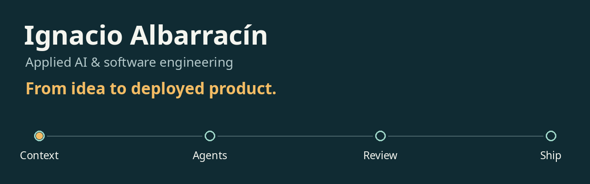

<picture>
  <source media="(prefers-reduced-motion: reduce)" srcset="./assets/profile-static.png">
  
</picture>

# Hi, I'm Ignacio.

I build software from the first product decision to production — and use AI agents throughout the process.

Based in **Tucumán, Argentina**. Finishing my **Informatics Engineering degree at UNSTA**, with a capstone focused on local language models and Spanish voice-scam detection.

[LinkedIn](https://www.linkedin.com/in/ignacio-albarracin/) · [Email](mailto:ignacioalbarracin15@gmail.com) · [Jugatta](https://jugatta.online)

## What I'm building

### [Jugatta ↗](https://jugatta.online)
Automatic match recording for sports venues. I took the product from concept and architecture through development, deployment and commercial sale. It is currently operating at **one venue**.

Camera-to-cloud ingestion, FFmpeg processing, booking-based video delivery, player access and venue commissions — built with Laravel, Livewire, PostgreSQL, Docker, Oracle Cloud and Cloudflare R2.

### [Local AI for voice-scam detection ↗](https://github.com/Corchets/bitacora_tesis)
My engineering capstone, built with a four-person team. I develop and analyze experiments with encoder classifiers, quantized language models and classifier-to-LLM cascades.

Our comparison matrix covers **10 models, 3 configurations and 20 conversations: 600 evaluation runs**. I work on prompts, structured outputs, false alarms, token usage, latency and memory with Python, PyTorch, Hugging Face Transformers, scikit-learn and Ollama.

These are team experiments on synthetic development data, rather than a production accuracy claim.

### [Omarchy Genie ↗](https://github.com/nacho1706/omarchy-genie)
An MIT-licensed plugin that brings Genie-style window minimization and restoration to the Omarchy dock. QML, Python and GPU shaders, with **13 regression tests** and documented live integration checks.

I also built [Dock Window Counter](https://github.com/nacho1706/omarchy-dock-window-counter) and submitted both plugins to the [Omarchy community marketplace](https://github.com/omacom/omarchy-plugin-marketplace). Genie is still under review.

Watch Genie in action

 

[Source and installation instructions](https://github.com/nacho1706/omarchy-genie#readme)

## How I work

**Claude Code for coding. Orca for agent orchestration.** I define the domain, architecture and context, break the work into small tasks, then review and validate the result.

My background is in backend and full-stack development: custom business systems, conversational workflows, REST APIs and cloud delivery. Today, I'm bringing that experience into applied AI products.

| Focus | Tools I use |
| :--- | :--- |
| Applied AI | Python, PyTorch, Transformers, scikit-learn, Ollama, RAG, Qdrant, n8n |
| Backend | PHP, Laravel, Go, PostgreSQL, MySQL, REST APIs |
| Interfaces | React, Next.js, Livewire, Tailwind CSS |
| Delivery | Docker, GitHub Actions, AWS S3/CloudFront, Oracle Cloud, Linux |

## More things I've shipped

- **[NutriMezzo](https://github.com/nacho1706/nutrimezzo)** — a local-first calorie and macro tracker built with Flutter, with bring-your-own-key AI assistance.
- **[Laravel AI Wire Base](https://github.com/nacho1706/laravel-ai-wire-base)** — a Dockerized Laravel + Livewire + AI starting point.

---

**Interested in applied AI, agent workflows or building a product together?** [Let's talk.](mailto:ignacioalbarracin15@gmail.com)

Spanish (native) · English (B2) · [Static banner](./assets/profile-static.png)
